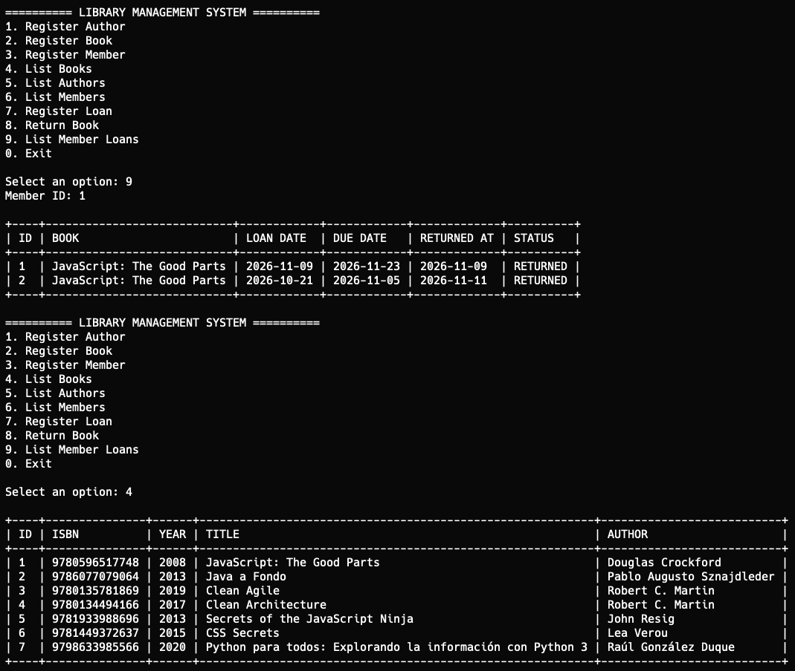
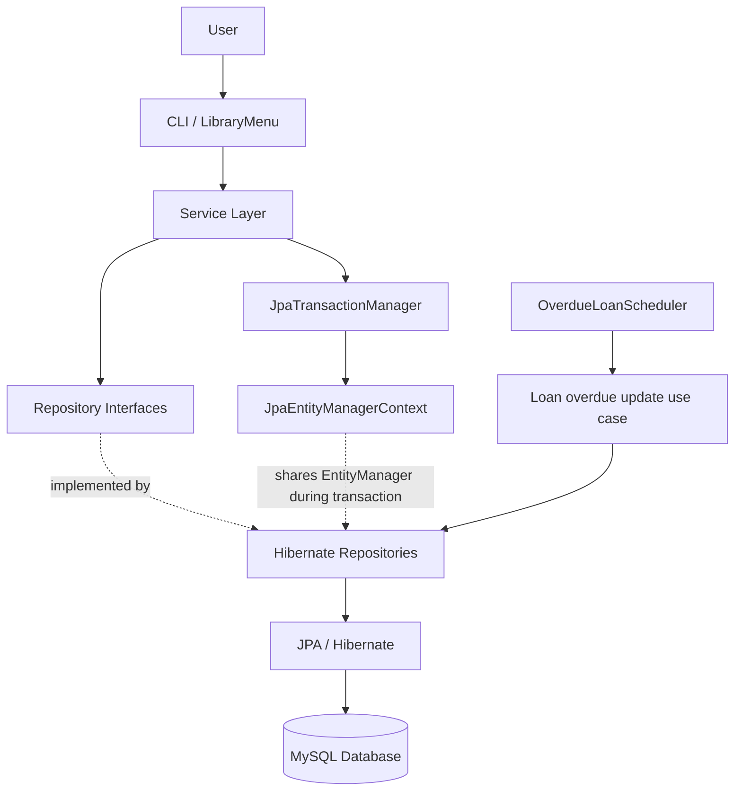
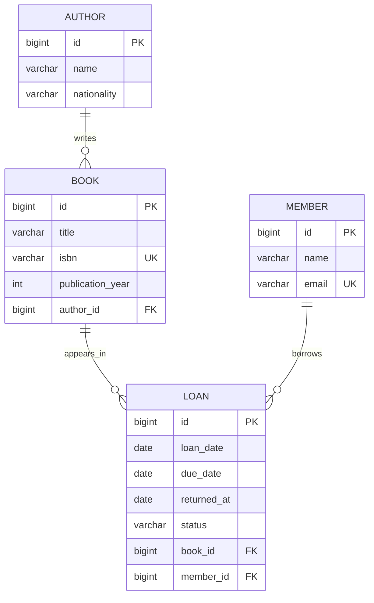

# Library Management System

A Java SE application for managing a small library. It supports authors,
books, members, and loans, using MySQL for persistence and Hibernate/JPA
for object-relational mapping.

The project was built as a hands-on exercise in Java backend
development, layered architecture, persistence, transaction management,
and Hibernate.

## Application Preview

### Main Menu



## Features

-   Register and list authors.
-   Register and list books, associated with an author.
-   Register and list library members.
-   Register book loans for members.
-   Prevent a book from being loaned while it has an active or overdue
    loan.
-   Return a loan and record its return date.
-   List a member's loan history.
-   Automatically mark active loans as overdue when their due date has
    passed.
-   Run the application through a command-line interface.

## Technology stack

  Technology                      Purpose
  ------------------------------- ------------------------------------
  Java 25                         Application language and runtime
  Maven                           Dependency and build management
  MySQL 9.2                       Relational database
  Jakarta Persistence (JPA) 3.2   Persistence API and entity mapping
  Hibernate ORM 7.4               JPA implementation / ORM
  MySQL Connector/J               MySQL JDBC driver
  JUnit 5                         Unit testing
  Mockito                         Mocking dependencies in unit tests

> Versions reflect the development environment used for this project.
> Adjust them if your `pom.xml` uses different versions.

## Architecture

The application follows a layered architecture. The command-line
interface delegates use cases to services. Services contain application
and business rules and depend on repository interfaces. Hibernate-backed
repositories implement those interfaces and use JPA to access MySQL.



### Main layers

-   **CLI:** Reads user input, displays results, and invokes service
    methods. It does not contain persistence logic.
-   **Service:** Coordinates use cases and enforces business rules, such
    as validating loan dates and preventing a book from having more than
    one unreturned loan.
-   **Repository contracts:** Define persistence operations without
    exposing Hibernate or `EntityManager` details to the service layer.
-   **Persistence infrastructure:** Implements repositories with
    Hibernate/JPA and manages database access.
-   **Transaction manager:** Creates an `EntityManager`, starts and
    commits or rolls back a transaction, and closes the persistence
    context. A `ThreadLocal` context lets repositories reuse the same
    `EntityManager` during a service transaction.
-   **Scheduler:** Uses Java's `ScheduledExecutorService` to
    periodically identify and update overdue loans.

## Package structure

The structure below describes the main responsibilities. Keep the names
aligned with the actual source tree if you have made further package
changes.

``` text
src/
└── main/
    ├── java/
    │   └── com/library/
    │       ├── LibraryApplication.java
    │       ├── domain/
    │       │   ├── entity/
    │       │   │   ├── Author.java
    │       │   │   ├── Book.java
    │       │   │   ├── Member.java
    │       │   │   └── Loan.java
    │       │   └── enums/
    │       │       └── LoanStatus.java
    │       ├── dto/
    │       │   └── BookSummaryDTO.java
    │       ├── repository/
    │       │   ├── AuthorRepository.java
    │       │   ├── BookRepository.java
    │       │   ├── MemberRepository.java
    │       │   └── LoanRepository.java
    │       ├── service/
    │       │   ├── AuthorService.java
    │       │   ├── BookService.java
    │       │   ├── MemberService.java
    │       │   └── LoanService.java
    │       ├── infrastructure/
    │       │   └── persistence/
    │       │       ├── HibernateAuthorRepository.java
    │       │       ├── HibernateBookRepository.java
    │       │       ├── HibernateMemberRepository.java
    │       │       ├── HibernateLoanRepository.java
    │       │       ├── JpaTransactionManager.java
    │       │       └── JpaEntityManagerContext.java
    │       ├── presentation/
    │       │   ├── LibraryMenu.java
    │       │   └── ConsoleTable.java
    │       └── scheduler/
    │           └── OverdueLoanScheduler.java
    └── resources/
        └── META-INF/
            └── persistence.xml
```

## Domain model



A book belongs to one author. A loan references one book and one member.
A book and a member can each be associated with multiple loans over
time.

Loan statuses:

-   `ACTIVE`: the loan has not been returned and is not yet overdue.
-   `OVERDUE`: the due date has passed and the loan has not been
    returned.
-   `RETURNED`: the book has been returned.

## Important implementation concepts

-   **JPA entity mapping:** Entities model the domain and map to
    relational tables.
-   **Repository abstraction:** Services depend on interfaces rather
    than concrete Hibernate implementations.
-   **Lazy relationships:** `ManyToOne` relationships are configured for
    lazy loading; queries use `JOIN FETCH` when related data must be
    available after the persistence context closes.
-   **DTO projection:** A book summary query projects selected fields
    into `BookSummaryDTO` instead of returning full entities.
-   **Persistence context and dirty checking:** Changes to managed
    entities are detected and synchronized with the database when the
    transaction commits.
-   **Transactions:** Loan creation and return operations run within a
    transaction. The transaction manager commits on success and rolls
    back on runtime failure.
-   **Pessimistic locking:** Loan creation locks the selected book row
    to reduce the risk of concurrent requests creating overlapping
    active loans.
-   **Scheduled processing:** The overdue-loan task updates eligible
    active loans based on their due dates.

## Database setup

1.  Install and start MySQL.
2.  Create the database:

``` sql
CREATE DATABASE library_db;
```

3.  Open the following configuration file:

``` text
src/main/resources/META-INF/persistence.xml
```

4. Update the database connection properties with your local MySQL credentials:

``` xml
<property name="jakarta.persistence.jdbc.url"
          value="jdbc:mysql://localhost:3306/library_db"/>

<property name="jakarta.persistence.jdbc.user"
          value="YOUR_DATABASE_USERNAME"/>

<property name="jakarta.persistence.jdbc.password"
          value="YOUR_DATABASE_PASSWORD"/>
```

Replace YOUR_DATABASE_USERNAME and YOUR_DATABASE_PASSWORD with your local MySQL credentials before running the application.

5. The project uses Hibernate schema generation with hibernate.hbm2ddl.auto=update, which automatically creates or updates the database tables based on the mapped entities.

Note: The credentials shown in persistence.xml are placeholders. Never commit real database credentials to a public repository.

## Build and run

Build the project:

``` bash
mvn clean package
```

Run `com.library.LibraryApplication` from your IDE, or configure a Maven
execution plugin if you want to launch it from the command line.

The application initializes the persistence layer, constructs
repositories and services, and starts the library menu. Follow the
prompts to manage authors, books, members, and loans.

## Testing

The project includes JUnit 5 and Mockito tests. The service layer is a
good place for unit tests because repository dependencies can be mocked.

Run the available tests with:

``` bash
mvn test
```

Database-backed repository tests require a running MySQL instance and a
correctly configured persistence unit. Document any additional test
database requirements if you add integration tests.

## Scope and possible next steps

This is a Java SE learning project, not a Spring Boot web application.
It currently exposes a command-line interface rather than REST
endpoints.

Possible extensions:

-   Add integration tests for repositories and transaction behavior.
-   Add pagination and more search/filter operations.
-   Move schema management to Flyway or Liquibase.
-   Add a Spring Boot REST API and a separate frontend.
-   Add authentication and authorization if the application becomes
    multi-user.

## License

Add a license file if you intend to distribute or reuse this project
publicly.
